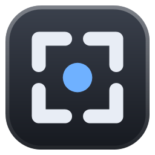
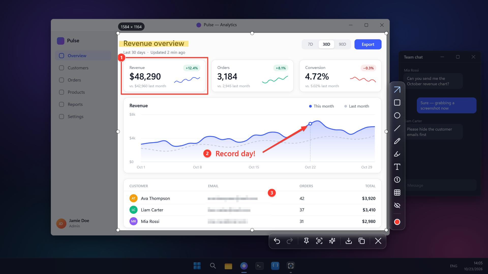
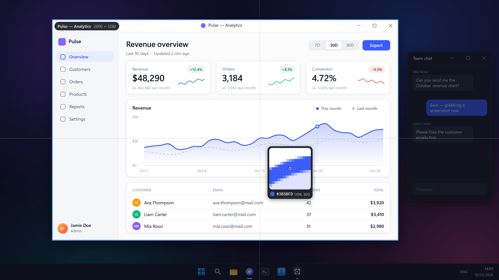
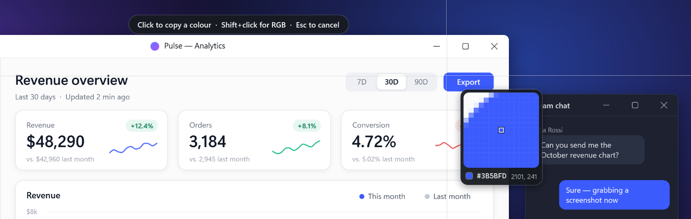
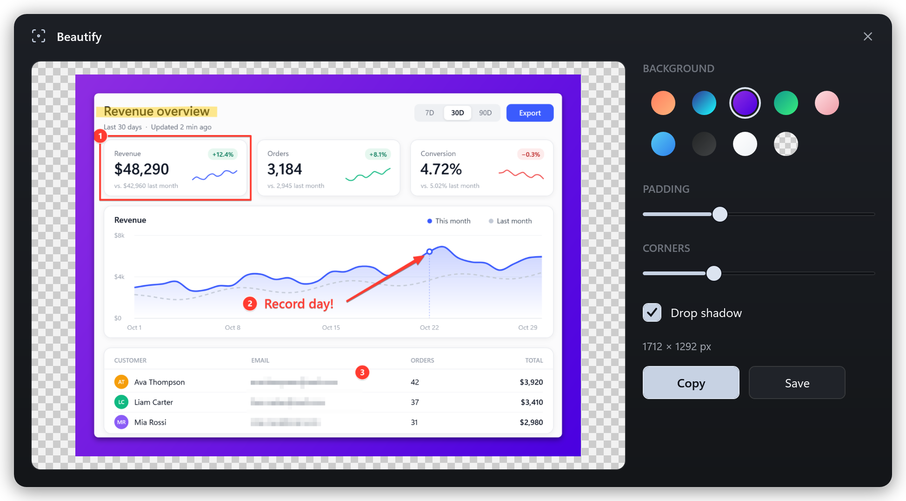
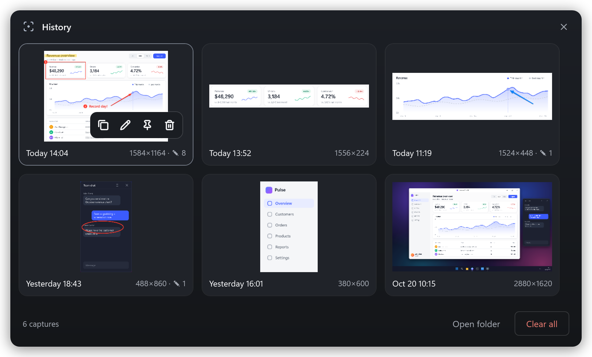
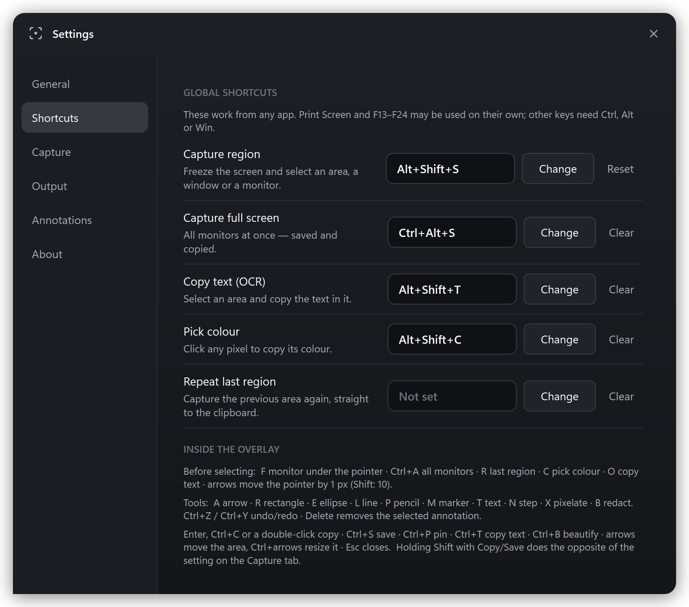
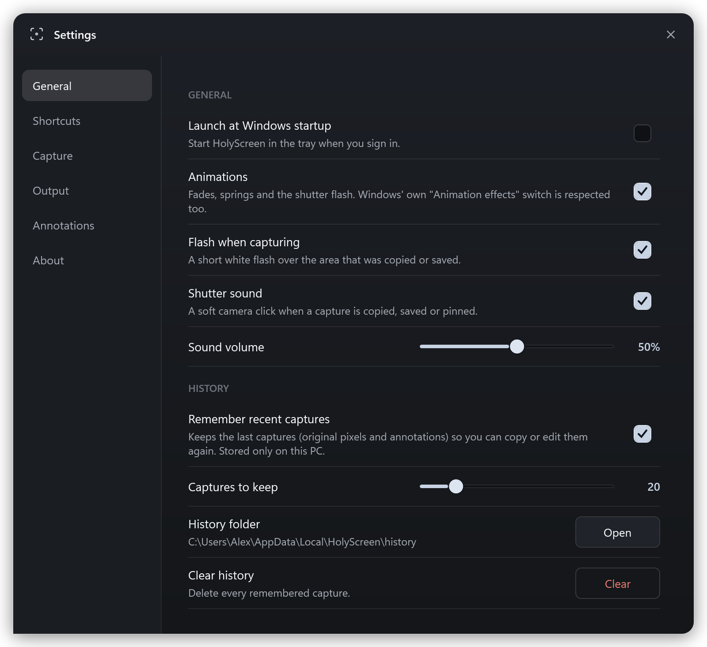
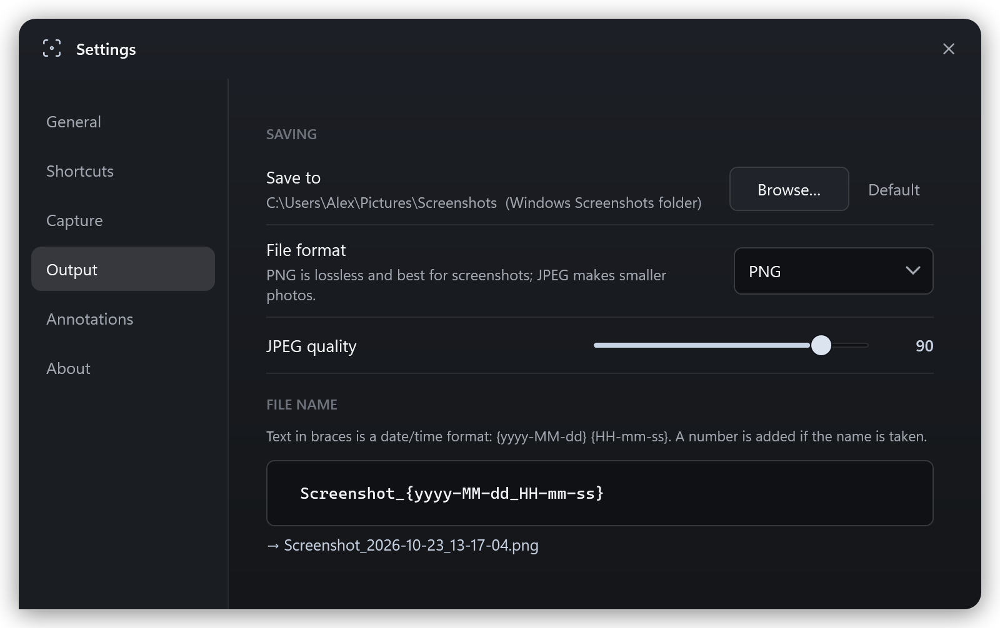

<p align="center">
  
</p>

<h1 align="center">HolyScreen</h1>

<p align="center">
  <b>Freeze the screen. Select. Annotate. Copy.</b><br>
  A fast, minimal screenshot tool for Windows that lives in the tray — the Lightshot flow, with the useful extras of ShareX.
</p>

<p align="center">
  
  
  
  
  
  
</p>

<p align="center">
  
</p>

Press **Alt + Shift + S**: the screen freezes, you drag an area (or click a window), annotate it right there, and
**copy** or **save**. No main window, no account, no cloud, no administrator rights — a native **C# / .NET 10 + WPF**
app with a dark frosted-glass interface, shipped as **one standalone .exe**.

---

## Highlights

- **Frozen-screen overlay** on every monitor, each at its own DPI (per-monitor v2). What you select is copied pixel for
  pixel — no scaling, no blur. After a warm-up at start-up the overlay appears about 90 ms after the shortcut.
- **Smart selection** — drag an area or click a window, the taskbar or a monitor (the selection snaps to window
  bounds); live size in pixels, a magnifier with the colour under the pointer, and keyboard nudging by 1 px.
- **Editable annotations** — arrow, rectangle, ellipse, line, pencil, marker, text, numbered steps, pixelate and redact,
  with a colour/size palette. Anything you drew can be selected, moved, resized or deleted, with undo/redo. What you
  see in the editor is exactly what is copied.
- **Copy & Save** — Copy puts a PNG on the clipboard (plus a classic bitmap for older apps) and closes the editor; Save
  writes PNG or JPEG to *Pictures\Screenshots* as `Screenshot_2026-10-23_14-05-01.png`. Holding **Shift** does the
  opposite of the "close after copy/save" setting.
- **Pin to screen** — a borderless, always-on-top copy you can move, zoom (wheel) and fade (Ctrl + wheel).
- **Copy text (OCR)** — Windows' built-in OCR; every installed OCR language is tried and the most plausible reading
  wins (so Cyrillic text is not "read" as Latin look-alikes).
- **Colour picker** — click any pixel to copy `#RRGGBB` (or `rgb()`).
- **Beautify** — gradient background, padding, rounded corners and shadow, for sharing a screenshot.
- **Full screen**, **repeat the last area**, and a **3 / 5-second timer** (for open menus and tooltips).
- **History** — recent captures keep their original pixels and annotations, so they can be copied, pinned or edited
  again later.
- **Settings** — recorded shortcuts with conflict checks, save folder / format / file-name template with a live
  preview, after-copy behaviour, auto-copy, magnifier, flash, shutter sound, annotation defaults, history, startup.

---

## A quick tour

### Grab a window, an area or a monitor



Hover a window and it lights up with its title and size — a click takes exactly that window (its visible frame, without
the invisible resize border). Drag for any area instead: the crosshair and the magnifier show the exact pixel under the
pointer and its colour. **F** takes the monitor under the pointer, **Ctrl + A** all monitors, **R** the previous area.

### Annotate, then copy

The toolbars hug the selection like in Lightshot — actions under it, tools beside it (see the picture at the top). Every
mark stays editable until you copy: click it to move or resize it, change its colour or size, delete it, undo, redo.
**Enter** copies and closes, **Ctrl + S** saves, **Ctrl + P** pins it to the screen.

### Pick a colour



Click any pixel to copy its `#RRGGBB`, or Shift + click for `rgb()`. Give it its own shortcut, or press **C** in the
overlay.

### Beautify before sharing



### History and settings

<table>
  <tr>
    <td width="50%"></td>
    <td width="50%"></td>
  </tr>
</table>

<details>
<summary>More settings</summary>
<br>


</details>

<sub>These pictures are rendered by HolyScreen's own UI code — the real overlay, toolbars and windows — on a made-up
desktop, so no real screen or personal data appears in them.</sub>

---

## Requirements

| | |
|---|---|
| OS | Windows 10 version 1809 (build 17763) or later, and Windows 11 |
| Runtime | Nothing for the standalone exe (it carries .NET 10 and WPF). The framework-dependent build needs the **.NET 10 Desktop Runtime**. |
| Build | **.NET 10 SDK** (`dotnet --version` ≥ 10.0) |
| Privileges | Standard user. Administrator rights are **not** required. |

> **Tested on:** Windows 11 (build 26200), .NET 10.0.13, two monitors, at 100 % and with one monitor at 150 % (mixed
> DPI). Windows 10 has not been verified yet. See *Testing status* below.

---

## Quick start

```powershell
# from the repository root
.\build.ps1 build        # compile (Debug)
.\build.ps1 test         # unit tests
.\build.ps1 run          # build and launch (appears in the system tray)
```

Press **Alt + Shift + S** to capture. Right-click the tray icon for everything else; left-click it to capture.

### One standalone exe

```powershell
.\build.ps1 publish                      # .\dist\HolyScreen.exe — the only file, about 65 MB
.\build.ps1 publish -FrameworkDependent  # smaller, needs the .NET 10 Desktop Runtime on the target PC
```

Copy `HolyScreen.exe` anywhere and run it — no installer, no files next to it. The first start of a new version unpacks
the runtime once into `%TEMP%\.net\HolyScreen\<hash>` (about 140 MB, 2–3 seconds); every later start takes under half a
second. That cache is deliberate: assemblies are then mapped from disk like a normal installation (13 MB of private
memory right after start-up). A compressed single file that does not extract inflates every assembly into private
memory instead — 60–115 MB more, for as long as the tray app runs — and an uncompressed one would be a 200 MB exe.

The in-app **Launch at Windows startup** switch registers the exe in the per-user `Run` key.

---

## Shortcuts

**Global** (Settings → Shortcuts; record any Ctrl / Alt / Shift / Win + key, or Print Screen / F13–F24 on their own):

| Action | Default |
|---|---|
| Capture region | **Alt + Shift + S** |
| Capture full screen (saved and copied) | not assigned |
| Copy text (OCR) | not assigned |
| Pick colour | not assigned |
| Repeat last region (straight to the clipboard) | not assigned |

**In the overlay:**

| Before selecting | |
|---|---|
| drag / click | select an area / the window or monitor under the pointer |
| F · Ctrl + A · R | monitor under the pointer · all monitors · the previous area |
| C · O | switch to colour picking · switch to copying text |
| arrows (Shift: ×10) | move the pointer by one pixel |
| Esc or right-click | close |

| After selecting | |
|---|---|
| A R E L P M T N X B | arrow, rectangle, ellipse, line, pencil, marker, text, step, pixelate, redact |
| Enter, Ctrl + C, double-click | copy |
| Ctrl + S · Ctrl + P · Ctrl + T · Ctrl + B | save · pin · copy text · beautify |
| Ctrl + Z · Ctrl + Y | undo · redo |
| Delete | remove the selected annotation |
| arrows · Ctrl + arrows | move the area (or the selected annotation) · resize the area |
| mouse wheel | change the stroke or text size |
| Shift + Copy/Save | do the opposite of "close after copy/save" |

---

## The global shortcut and privacy

Shortcuts are registered with Windows' **`RegisterHotKey`** only. Windows notifies the app when that exact combination
is pressed and nothing else: there is **no keyboard hook** and the app never sees any other keystroke. `MOD_NOREPEAT`
makes a held shortcut fire once. A shortcut that is invalid, reserved by Windows (such as Win + Shift + S) or already used
by another program is refused with a clear message and never replaces the one that works. While a shortcut is being
recorded in Settings, the global shortcuts are switched off so the keys reach the recorder.

To use **Print Screen**, turn off *Settings › Accessibility › Keyboard › Use the Print screen key to open screen
capture*, otherwise Windows gives the key to the Snipping Tool.

---

## How it works (architecture)

All native calls live in a single, auditable interop file.

```
src/HolyScreen/
  Interop/Win32.cs           Every P/Invoke declaration, in one place.
  Core/                      Paths, log, settings, single instance, startup registration, history store,
                             command line, the hidden message window (hotkeys, display and resume events).
  Input/                     Shortcut model (parse / validate / display) and the RegisterHotKey manager.
  Capture/                   Pixel rectangles, monitor layout, window list, BitBlt capture of the whole desktop.
  Editor/                    Annotation model (JSON), commands with undo/redo, hit-testing and handles,
                             the renderer shared by the editor and the export, and the editor itself.
  Output/                    File names, the Screenshots folder, PNG/JPEG encoding, saving, clipboard, OCR.
  UI/
    Overlay/                 The frozen-screen session, its per-monitor windows (pooled), selection chrome,
                             magnifier, glass panels.
    Pin/ Beautify/ History/  Pinned captures, the beautify window, the history window.
    Settings/                Tabbed settings and the shortcut recorder.
    Tray/ Toast/ Common/     Tray icon and menu, toasts and countdown, icons, window chrome, motion, sound.
    Theme/                   Colours and control styles.
  CaptureController.cs       Runs captures and acts on their results (copy, save, pin, OCR, history…).
  AppHost.cs                 Wires everything together; owns the application lifecycle.
```

**Capture.** The shortcut freezes the whole virtual desktop with one `BitBlt` (`CAPTUREBLT`, so layered windows are
included) into a top-down 32-bit buffer, together with the monitor and window layout of that moment. Every monitor then
gets an opaque, borderless overlay window placed in physical pixels at that monitor's DPI; windows are created once,
pooled, and revealed only after their first frame is on screen, so the frozen image never flickers or shifts.
Annotations are stored in screen pixels and rendered by the same code in the editor and in the exported image.

**Lifecycle.** `App` parses the command line and enforces a single instance per data directory — launching the exe again
forwards the command (capture by default) to the running one. `AppHost` creates the tray icon, registers the shortcuts
and, once idle, runs one invisible overlay warm-up so that the first real capture is as fast as the rest.

---

## Privacy

- **Nothing leaves the PC.** The app contains no network code; OCR is the local Windows engine.
- **History is local and optional**: `%LOCALAPPDATA%\HolyScreen\history`, limited to the last N captures, can be turned
  off or cleared in Settings.
- **Logs** record sizes, timings and errors only — never screenshot content, window titles or recognised text.
- **No keyboard hook** (see above).

---

## Data & file locations

Everything is stored under `%LOCALAPPDATA%\HolyScreen\`:

| Path | Contents |
|---|---|
| `settings.json` | Preferences |
| `logs\app.log` | Diagnostics (no screenshot content) |
| `history\<capture>\` | `original.png`, `result.png`, `thumb.png`, `annotations.json`, `meta.json` |

Screenshots go to the Windows *Screenshots* folder (normally `Pictures\Screenshots`, OneDrive-aware) unless another
folder is chosen. *Launch at Windows startup* is the registry value `HKCU\Software\Microsoft\Windows\CurrentVersion\Run\HolyScreen`.

**Command line:** `--capture`, `--capture-full`, `--capture-delayed`, `--history`, `--settings`, `--exit`, and
`--data-dir "<path>"` for a portable / isolated data directory.

---

## Settings (from the tray)

**General** — startup, animations, capture flash, shutter sound and volume, history on/off, captures to keep, clear.
**Shortcuts** — record, reset or clear each global shortcut, plus the overlay key reference.
**Capture** — close after Copy / Save, copy as soon as an area is selected, magnifier.
**Output** — save folder, PNG/JPEG, JPEG quality, file-name template with a live preview.
**Annotations** — default colour, stroke size and text size.
**About** — version, environment, installed OCR languages, data and log folders.

---

## Testing status

- **Unit tests (133, all passing):** shortcut parsing/validation, pixel-rectangle and selection geometry, monitor
  layout, capture buffers, file names and encoding, clipboard formats, settings round-trip, annotation editing, undo
  chains, hit-testing and rendering (incl. pixelation), OCR (English and Russian, plus the plausibility scoring),
  history store, beautify, the shutter-sound WAV, shortcut suspension while recording, button label colours, and the
  settings window (builds every tab, writes every control to the settings file). Run with `.\build.ps1 test`.
- **End-to-end tests (real mouse and keyboard, `.\build.ps1 e2e`):** passed during development — full-screen capture,
  drag-copy on both monitors, cross-monitor save, window click, keyboard nudge, cancel paths, panels, annotate, edit
  annotations, palette, mixed DPI (one monitor switched to 150 % and back), timer. Written but not yet run to
  completion: pin, OCR, colour picker, beautify, history re-edit, repeat region, settings, memory over repeated
  captures. A full re-run on the final build is pending.
- **Standalone exe:** run from an empty folder — starts in 0.4 s (2.8 s on the first start of a version), writes
  nothing next to itself, exits cleanly.

The E2E run injects real input. It starts only while the terminal that launched it is in front, sends keys and clicks
only to HolyScreen's own windows (never into the terminal or an editor), and stops by itself if any other application
comes forward — so start it, then leave the mouse and keyboard alone for a few minutes. Your clipboard text is put back
afterwards. Screenshots of each step are kept under `artifacts\` (ignored by git — they contain whatever was on your
screen).

```powershell
.\build.ps1 e2e                                        # against the Debug build
.\build.ps1 e2e -E2EArgs '--exe','dist\HolyScreen.exe' # against the published standalone exe
.\build.ps1 e2e -E2EArgs '--only','settings'           # one scenario
```

---

## Known limitations

- Some full-screen games swallow global shortcuts while they are in front (observed with Dota 2); capture from the tray
  icon instead.
- Protected content (DRM video, some exclusive-full-screen games) is captured as black — Windows does not hand those
  pixels to `BitBlt`.
- Memory: about 130 MB of private memory once the start-up warm-up has run (13 MB before it) — most of it is the
  graphics driver's share of WPF's hardware rendering, which every WPF app that has drawn on the GPU pays.
- OCR reads the languages installed for Windows OCR (*Settings › Time & language › Language & region › add a language
  with "Optical character recognition"*).

---

## License / attribution

Icon glyphs are from the [Lucide](https://lucide.dev) icon set (ISC license). The remainder is original project code.
